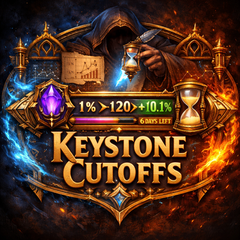
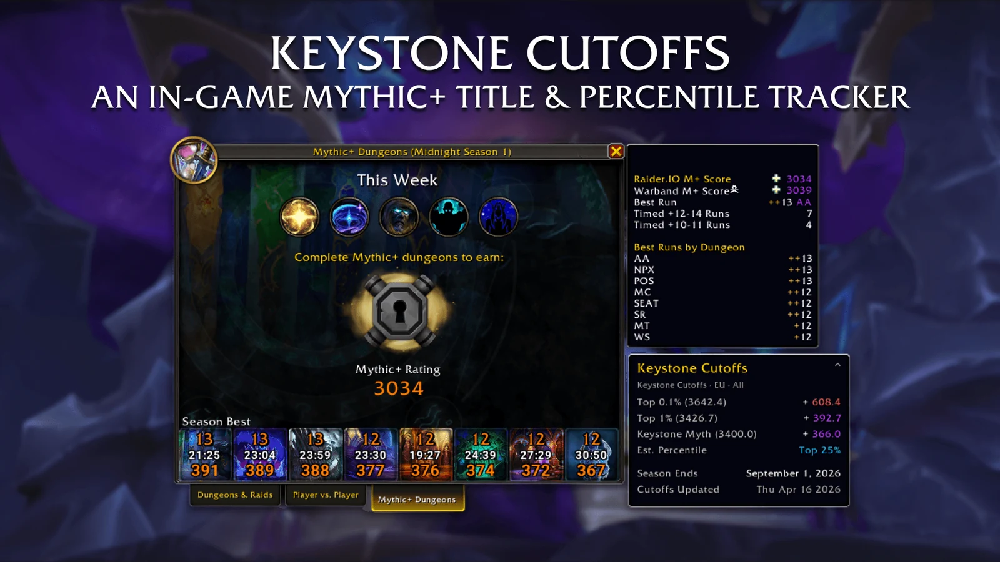
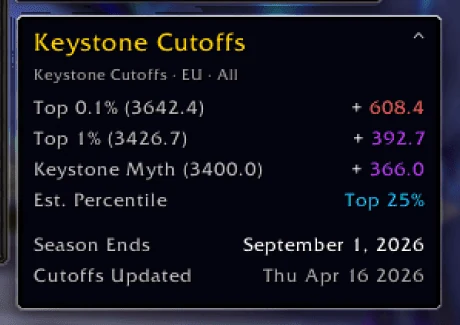
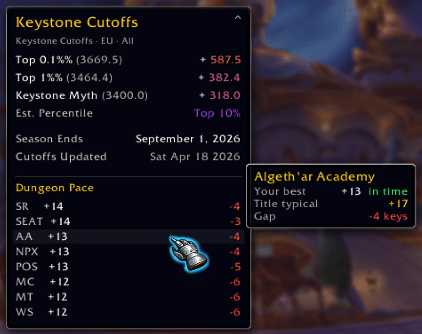
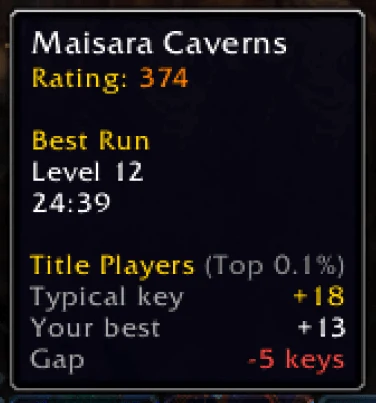
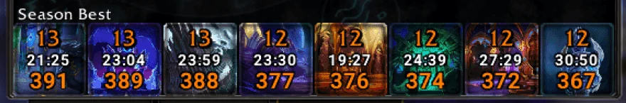
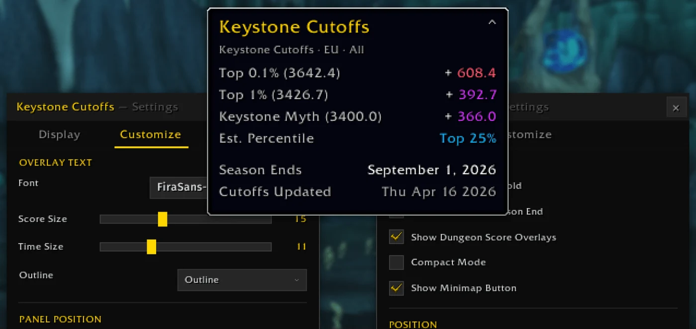
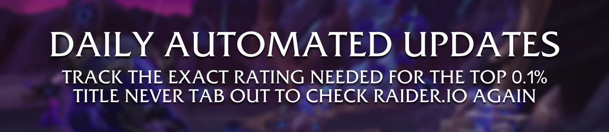

<p align="center">
  
</p>

<h1 align="center">Keystone Cutoffs</h1>

<p align="center">
  <b>Know exactly how far you are from the title.</b>
</p>

<p align="center">
  A World of Warcraft addon that puts live Mythic+ rating cutoffs right next to your own score.<br>
  See your gap to the top 0.1% title and every percentile bracket, without tabbing out to Raider.IO.
</p>

<p align="center">
  <sub>World of Warcraft Retail &nbsp;·&nbsp; EU, US, KR and TW &nbsp;·&nbsp; Updated every day &nbsp;·&nbsp; Free</sub>
</p>

<p align="center">
  <a href="https://www.curseforge.com/wow/addons/keystone-cutoffs"></a>
  <a href="https://www.curseforge.com/wow/addons/keystone-cutoffs"></a>
</p>

<p align="center">
  <a href="https://www.curseforge.com/wow/addons/keystone-cutoffs"><b>Download on CurseForge</b></a> &nbsp;·&nbsp;
  <a href="#features">Features</a> &nbsp;·&nbsp;
  <a href="#getting-started">Getting started</a> &nbsp;·&nbsp;
  <a href="#feedback">Feedback</a>
</p>

<p align="center">
  <a href="https://www.buymeacoffee.com/xtendr"></a>
</p>

<br>



```
Open the Mythic+ window  →  See your gap to every cutoff  →  Push the right keys  →  Earn the title
```

## Features

### Your gap to every cutoff, at a glance

<p align="center">
  
</p>

Open the Mythic+ Dungeons window and Keystone Cutoffs sits right beside it. It shows the rating each bracket needs
this season, how many points you are away from it, and roughly where your score places you on your region's ladder.

| | What you see |
| --- | --- |
| **Top 0.1%** | The rating for this season's title, and how far away you are |
| **Top 1%, 10% and 25%** | The other percentile brackets for your region |
| **Achievements** | Thresholds like Keystone Myth, so you know when the next one unlocks |
| **Est. Percentile** | Where your current score lands on the ladder |
| **Season Ends** | When the season closes in your region |

### Dungeon Pace: see where the title is won

<table>
  <tr>
    <td width="62%" valign="top">
      
    </td>
    <td width="38%" valign="top">
      
      <p>Hover a dungeon to see your best run next to the key title players usually time there.</p>
    </td>
  </tr>
</table>

Dungeon Pace compares your best key in every dungeon with what top 0.1% players typically complete. The list shows
your gap in key levels, so you can see at a glance which dungeons are holding your rating back and where your next
push should be.

### Your scores, right on the dungeon icons



Your best key level, time and score sit directly on Blizzard's own dungeon icons. Scores use the game's familiar
rarity colours, so a quick look tells you which dungeons are strong and which need another run.

### Make it match your UI



Pick any SharedMedia font for the overlays and preview it live. Set the text size, outline and shadow until it reads
well with the rest of your interface. Turn on **Compact Mode** when you only want the essentials, collapse the panel
when you don't need it, and hold **Shift** to drag it wherever you like.

### Always up to date



Cutoffs are refreshed from Raider.IO every day and shipped as a normal addon update, so the numbers are there the
moment you log in. Every region is checked before an update goes out. If anything is missing, you keep the last good
numbers instead of a half-finished set. When a new season starts, the addon switches over by itself once every region
has begun.

### Extra tools, off until you want them

The default panel stays light and simple. Turn on more from the **Goals** and **Advanced** tabs in settings:

- **Goal Mode:** focus the panel on one target: a percentile, an achievement or a custom score.
- **Cutoff Movement:** see how the cutoffs moved since the previous update.
- **Furthest-behind dungeon:** highlights the dungeon that is furthest from title pace.
- **Character tracking:** remembers the last known scores of your other characters.
- **Standalone panel:** keep the panel on screen outside the Mythic+ window, with its own size, opacity and position.
- **Detailed Ladder View:** a separate window with every percentile, achievement threshold and population number.
- **Works with [Keystone Meta](https://github.com/Xtendr/Keystone-Meta):** when both addons are on, they sit neatly side by side.

## Getting started

1. Install Keystone Cutoffs from [CurseForge](https://www.curseforge.com/wow/addons/keystone-cutoffs), with the
   CurseForge app or your favourite addon manager.
2. Log in and open the **Mythic+ Dungeons** window. The panel appears next to it.
3. Your region is picked automatically. You can change it, and everything else, in the settings.

| | Do this |
| --- | --- |
| **Open settings** | Type `/kc` or `/keystonecutoffs`, or left-click the minimap button |
| **Open the Mythic+ window** | Right-click the minimap button |
| **Move the panel** | Hold **Shift** and drag it |
| **Save space** | Turn on **Compact Mode** in the **Display** tab |
| **Change fonts and sizes** | Open the **Customize** tab |

## Feedback

Have an idea, found a bug or missing a feature? [Open an issue](https://github.com/Xtendr/Keystone-Cutoffs/issues)
here on GitHub or leave a comment on [CurseForge](https://www.curseforge.com/wow/addons/keystone-cutoffs).

## Credits

Mythic+ rating data comes from [Raider.IO](https://raider.io). Keystone Cutoffs is a community addon and is not
affiliated with or endorsed by Raider.IO or Blizzard Entertainment.

<br>

<p align="center">
  <sub>Made by <a href="https://github.com/Xtendr">Nicolai Brøndum Knudsen</a>.</sub>
</p>
